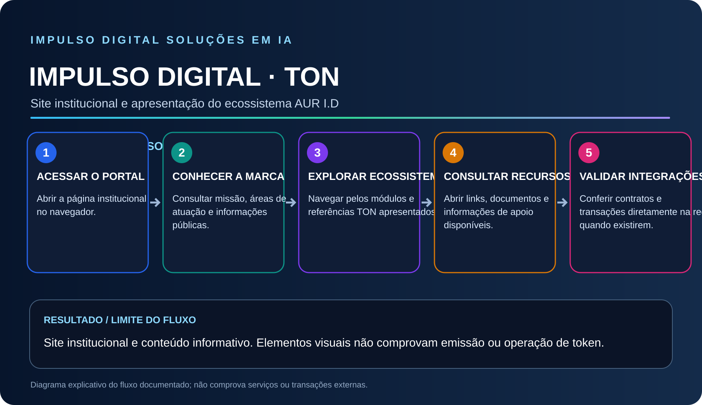
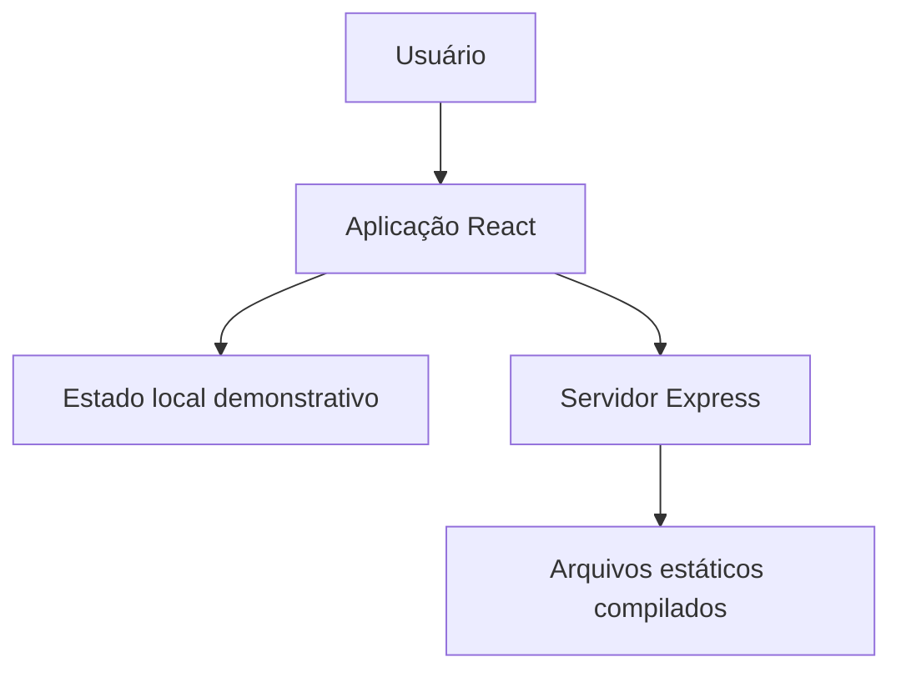

# Impulso Digital | AUR I.D — Interface demonstrativa TON

<p align="center"></p>


Aplicação web experimental que apresenta uma vitrine para o conceito AUR I.D associado ao ecossistema TON. O repositório contém uma interface React/Vite e um servidor Express que serve os arquivos estáticos compilados.

> **Aviso importante:** a interface contém estados e valores demonstrativos. A tela simula conexão de carteira, endereço de contrato, saldo e cálculo de recompensa; o código consultado não comprova conexão real com uma carteira TON, contrato inteligente implantado, staking, transações ou pool de liquidez. Não envie fundos nem utilize os valores exibidos como dados financeiros reais.

## Objetivo

Apresentar uma experiência visual para o conceito AUR I.D, organizar informações do ecossistema e servir como base para futuras integrações Web3, após implementação e auditoria independentes.

## Arquitetura observável

- **Frontend:** React 19 e TypeScript.
- **Build e desenvolvimento:** Vite.
- **Estilização e componentes:** Tailwind CSS e componentes React reutilizáveis.
- **Interações:** estado local do navegador e componentes de interface.
- **Servidor:** Express 4 para servir os arquivos estáticos e encaminhar rotas da aplicação para `index.html`.
- **Build de produção:** Vite compila o cliente; esbuild empacota o servidor TypeScript.



## Requisitos

- Node.js e npm.
- Acesso à internet para instalar as dependências.

## Instalação e execução

```bash
git clone https://github.com/felipetjmg1-bit/impulso-digital-ton.git
cd impulso-digital-ton
npm install
npm run dev
```

O script de desenvolvimento inicia o Vite. Use a URL local exibida no terminal.

## Comandos disponíveis

| Comando | Finalidade |
| --- | --- |
| `npm run dev` | Inicia o ambiente de desenvolvimento |
| `npm run build` | Compila o frontend e empacota o servidor |
| `npm run start` | Inicia o servidor empacotado em produção |
| `npm run preview` | Visualiza a build do Vite |
| `npm run check` | Executa a verificação TypeScript |
| `npm run format` | Formata os arquivos com Prettier |

## Segurança e integração TON

Antes de qualquer integração real:
1. Substitua os estados simulados por adaptadores de carteira oficiais e documentados.
2. Obtenha endereços de contratos de fontes verificáveis e publique a rede utilizada.
3. Nunca armazene seed phrases ou chaves privadas no frontend.
4. Faça revisão independente dos contratos inteligentes e dos cálculos financeiros.
5. Exiba claramente rede, taxas, riscos e estado real de cada transação.
6. Não prometa rendimento nem apresente simulações como retorno garantido.

## Estado do projeto

Protótipo de interface. A publicação deste código não constitui oferta de ativo, serviço financeiro, auditoria de contrato, garantia de rendimento ou recomendação de investimento.

## Contribuição

Pull requests devem incluir descrição, testes executados, screenshots quando relevantes e limitações conhecidas. Não inclua segredos, credenciais ou dados pessoais.

## Licença

O manifesto do projeto declara MIT. Consulte [LICENSE](LICENSE) para os termos efetivamente publicados.


**Empresa responsável:** Impulso Digital Soluções em IA.
